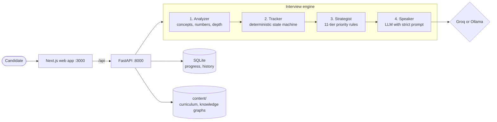

<div align="center">

# ArchitectIQ

### The system design interviewer that actually interviews you.

[](https://github.com/Ayush1906saxena/architectiq/actions/workflows/ci.yml)
[](https://ayush1906saxena.github.io/architectiq/)
[](https://github.com/Ayush1906saxena?tab=packages&repo_name=architectiq)


**[Website](https://ayush1906saxena.github.io/architectiq/)** · **[Run it in one command](#run-it)** · **[How the interviewer thinks](#architecture)** · **[API](#api)**

</div>

---

ArchitectIQ teaches system design from first principles, then puts you in a live mock interview with an AI interviewer that
probes, challenges, catches contradictions and adapts to your level. It doesn't quiz you with flashcards and it never gives
you the answer.

The interviewer runs on a **4-layer engine where only the final speech layer uses an LLM**. Tracking what you've covered,
deciding what to ask next and scoring you are deterministic code. The AI makes the conversation sound human; the rules make
the evaluation fair, and you can't talk your way into a better grade.

| | |
|---|---|
| **174 lessons** across 41 modules, tier 0 to 6 | **10 interview problems**, from URL shortener to payment system |
| **5 interviewer personas**, SDE2 mentor to CTO | **8 scored dimensions** per interview, with a rubric |
| **Adaptive quizzes** that drop to a simpler angle when you miss | **Failure labs, design challenges, daily streaks, leaderboard** |

## What makes it different

- **Never gives you the answer.** It only asks questions that reveal whether you know it.
- **Catches your contradictions.** *"Earlier you said eventual consistency is fine. But this design requires reading your own writes. Which is it?"*
- **Probes when you name-drop.** *"You said Kafka. Why Kafka and not RabbitMQ? What's the partition strategy?"*
- **Adapts to your level.** Warm and patient for SDE2, direct and unforgiving for Staff and above.
- **Scores you on 8 dimensions.** Not pass or fail: a scorecard that shows exactly where you're strong and where you're not.

## Run it

**With Docker** (prebuilt images from GitHub Packages, nothing to build):

```bash
git clone https://github.com/Ayush1906saxena/architectiq.git && cd architectiq
docker compose pull && docker compose up
```

| | |
|---|---|
| Web app | http://localhost:3000 |
| API and interactive docs | http://localhost:8000/docs |

No API key needed: the interviewer runs on the bundled Ollama, which pulls `llama3.2` (about 2 GB) on first start. For faster,
better answers, put a free [Groq](https://console.groq.com) key in `.env` (copy `.env.example`):

```bash
GROQ_API_KEY=gsk_... LLM_PROVIDER=groq docker compose up
```

To build the images yourself instead of pulling them: `docker compose up --build`.

**Without Docker:**

```bash
# API
cd backend
python -m venv .venv && source .venv/bin/activate
pip install -r requirements-dev.txt
uvicorn main:app --reload --port 8000        # needs Ollama running, or GROQ_API_KEY set

# Web app (another terminal)
cd frontend
npm ci && npm run dev                         # http://localhost:3000
```

### Images

Every push to `master` publishes both images to GitHub Packages, tagged `latest` and with the commit SHA:

| Image | |
|---|---|
| `ghcr.io/ayush1906saxena/architectiq-frontend` | Next.js standalone server, non-root, health-checked |
| `ghcr.io/ayush1906saxena/architectiq-backend` | FastAPI on uvicorn, Python 3.12, non-root, health-checked |

## The Platform

### 1. Structured Curriculum (Tier 0-6)

174 lessons across 41 modules, from "What is a Computer?" to "ML System Design":

| Tier | Focus | Modules |
|------|-------|---------|
| **0 - Foundations** | CPU, networking, databases, web basics | 4 |
| **1 - Single Server** | Web servers, storage, caching, concurrency | 4 |
| **2 - Distributed Systems** | Load balancing, sharding, replication, CAP, consensus | 7 |
| **3 - Design Patterns** | API gateways, message queues, microservices, observability | 5 |
| **4 - HLD Practice** | 10 classic system design problems with walkthroughs | 10 |
| **5 - LLD Practice** | Object-oriented design: parking lot, LRU cache, chess | 6 |
| **6 - Expert Mastery** | Database internals, distributed DB, data processing, ML systems | 5 |

### 2. Live Mock Interviews

The core feature. Choose a problem and career level, then design the system in a real-time conversation:

**10 Problems:**
URL Shortener, Rate Limiter, Key-Value Store, Twitter Feed, Chat System, Video Streaming, Search Engine, Ride Sharing, Payment System, Message Queue

**5 Career Levels:**

| Level | Interviewer Persona | Duration | What's Expected |
|-------|-------------------|----------|-----------------|
| **SDE2** | The Mentor — warm, patient | 30 min | Basic working design. Trade-offs are a bonus. |
| **Senior** | The Tech Lead — friendly but rigorous | 40 min | Drive the design. Do capacity math. Discuss trade-offs. |
| **Staff** | The Principal Engineer — direct, no hand-holding | 45 min | Drive everything. Go 2-3 levels deep. Production-grade failure handling. |
| **Principal** | The VP of Engineering — peer conversation | 50 min | Architecture across teams. Cost analysis. Migration strategy. |
| **VP** | The CTO — strategic, business-aligned | 55 min | Business context first. Regulatory. Org design. 3-year vision. |

**8-Dimension Scoring:**

Every interview produces a detailed scorecard:

```
Requirements Gathering  ████████░░  8/10
Capacity Estimation     ██████████  10/10
API Design              ██████░░░░  6/10
Database Design         ████████░░  8/10
Caching Strategy        ████████░░  8/10
Scalability             ██████████  10/10
Failure Handling        ████████░░  8/10
Communication           ████████░░  8/10

Overall: 82/100 — PASSED (Staff bar: 75)
```

### 3. Adaptive Quizzes

AI-generated quiz questions that adapt to your knowledge level. Get a question wrong, and the next one targets the same concept at a simpler angle.

---

## Architecture



| Layer | What it does | Uses an LLM? |
|---|---|---|
| **1. Analyzer** | Extracts concepts, numbers, decisions and depth signals from the candidate's text | Lightweight, with a keyword fallback |
| **2. Tracker** | Keeps the interview state: coverage, contradictions, depth, phase, rubric scores | No: a deterministic state machine |
| **3. Strategist** | Decides what to do next with an 11-tier priority system | No: deterministic rules |
| **4. Speaker** | Turns structured actions into natural interviewer dialogue | Yes: an LLM with a strict behavioural prompt |

**The LLM makes the interviewer sound human; deterministic code makes it smart.** The Strategist always catches
contradictions, always probes shallow claims and always moves on at the right time, whatever the model's quality. When the
model can't be reached, the interview still opens and runs in plain words instead of failing.

## API

```
GET    /api/interview/problems              List available problems
POST   /api/interview/start                 Start session {problem_id, career_level}
POST   /api/interview/message               Send message {session_id, message}
POST   /api/interview/{id}/end              End interview early
GET    /api/interview/{id}/scorecard         Get final scores
GET    /api/interview/{id}/state             Get live interview state
```

---

## Knowledge Graphs

Each problem has a knowledge graph (`content/knowledge-graphs/*.json`) that defines:

- **Concepts** the candidate should cover (e.g., `base62_encoding`, `redis_caching`, `sharding_strategy`)
- **Probes** per concept — verify, deepen, challenge, and anti-BS questions
- **Rubric mapping** — which concepts feed into which scoring dimensions
- **Keywords** for the response analyzer to detect without LLM

The Strategist uses this graph to decide what to ask next. If the candidate mentions "consistent hashing" at buzzword depth, the Strategist queues a verify probe. If they explain it well, it queues a challenge. If they never mention caching, the Strategist redirects them there.

## Testing and CI

```bash
cd backend && pytest -q        # offline: real content, a throwaway database, no model at all
```

The tests prove the main paths work with no model available: health, the full curriculum (every tier, 170+ lessons), a
lesson, the problem list, an interview that opens in plain words, and refusing an unknown career level.

[GitHub Actions](.github/workflows/ci.yml) runs on every push and pull request:

1. **API tests**: lint (ruff) and pytest on Python 3.12.
2. **Web app build**: type check and production build.
3. **Images**: both Docker images built every time, and published to GitHub Packages from `master`.

[A second workflow](.github/workflows/pages.yml) builds the [project website](https://ayush1906saxena.github.io/architectiq/)
from `site/` and deploys it to GitHub Pages.

## Configuration

| Variable | Default | Description |
|---|---|---|
| `LLM_PROVIDER` | `groq` (`ollama` in Docker) | `groq` or `ollama`; Groq without a key falls back to Ollama |
| `GROQ_API_KEY` | empty | Free key from console.groq.com |
| `GROQ_MODEL` | `llama-3.1-8b-instant` | Groq model |
| `OLLAMA_URL` | `http://localhost:11434` | Ollama endpoint |
| `OLLAMA_MODEL` | `llama3.2` | Ollama model |
| `NEXT_PUBLIC_API_URL` | `http://localhost:8000` | API address the browser uses |
| `API_INTERNAL_URL` | same as above | API address the web server uses for `/api` rewrites (Docker: `http://backend:8000`) |
| `CONTENT_DIR` | `./content` | Curriculum and knowledge graphs |
| `DB_PATH` | `./data/architectiq.db` | SQLite database |
| `JWT_SECRET` | `change-me-in-production` | Signing key for sessions; set it in production |
| `GOOGLE_*`, `GITHUB_*` | empty | Optional OAuth sign-in |

## Project Structure

```
architectiq/
  backend/
    api/                  FastAPI route handlers
    services/
      interview_engine.py     Orchestrator — coordinates all layers
      response_analyzer.py    Layer 1 — extract meaning from text
      interview_tracker.py    Layer 2 — deterministic state machine
      interview_strategist.py Layer 3 — priority-based action selection
      interview_speaker.py    Layer 4 — LLM-powered natural speech
      interview_scorer.py     8-dimension rubric scoring
      ollama_client.py        Ollama API client
    prompts/
      interviewer_system.md   Core behavioral constraints for the LLM
      personas.py             Level-calibrated interviewer personas
    models/                 Pydantic request/response models
    db/                     SQLite for progress tracking
    config.py               Pydantic Settings configuration

  frontend/
    src/app/
      interview/            Mock interview UI (selection + live chat)
      curriculum/           Lesson browser
      quiz/                 Adaptive quizzes
      design-challenge/     Design challenge walkthroughs
      ask/                  Ask Prof. Arch (Q&A)

  content/
    curriculum.json         Full curriculum tree (7 tiers, 41 modules, 174 lessons)
    challenges/             Problem definitions with rubrics and hints
    knowledge-graphs/       Concept graphs driving the interview strategist
    tier-0/ through tier-6/ Lesson content

  data/
    training/seed/          456 hand-crafted interview conversations for evaluation
    architectiq.db          User progress database

  site/                     Project website (Vite, three.js), deployed to GitHub Pages
  .github/workflows/        CI, images, Pages
```

---

## The Interviewer Prompt System

The LLM receives a ~6KB system prompt on every call that enforces:

**Absolute rules:**
1. Never give the answer — only hints and questions
2. Never exceed 4 sentences
3. Never break character (no "Great question!" or "That's an excellent point!")
4. Never lecture or explain concepts
5. Never repeat what the candidate said
6. Never use AI filler phrases

**Level-specific behavior:**
- SDE2: Hint after 1 pause. Celebrate small wins. Forgive missing capacity estimation.
- Senior: Ask "why" after every decision. Expect trade-off discussion.
- Staff: No hints. Probe failure modes aggressively. Expect 2-3 levels of depth.
- Principal: Ask about team structure, build-vs-buy, migration strategy.
- VP: Start with business context. Discuss compliance, cost modeling, 3-year vision.

---

## Tech stack

| | |
|---|---|
| Web app | Next.js 14, React 18, Tailwind, Framer Motion, D3, Zustand |
| API | FastAPI, Pydantic 2, Python 3.12 |
| Models | Groq (cloud, free tier) or Ollama (local), llama 3 family by default |
| Data | SQLite (progress), JSON (curriculum, knowledge graphs) |
| Delivery | Docker (multi-stage, non-root), Docker Compose, GitHub Actions, GitHub Packages, GitHub Pages |

## License

[MIT](LICENSE) © Ayush Saxena
